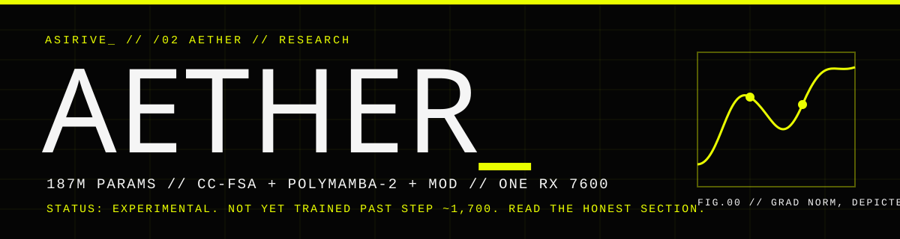
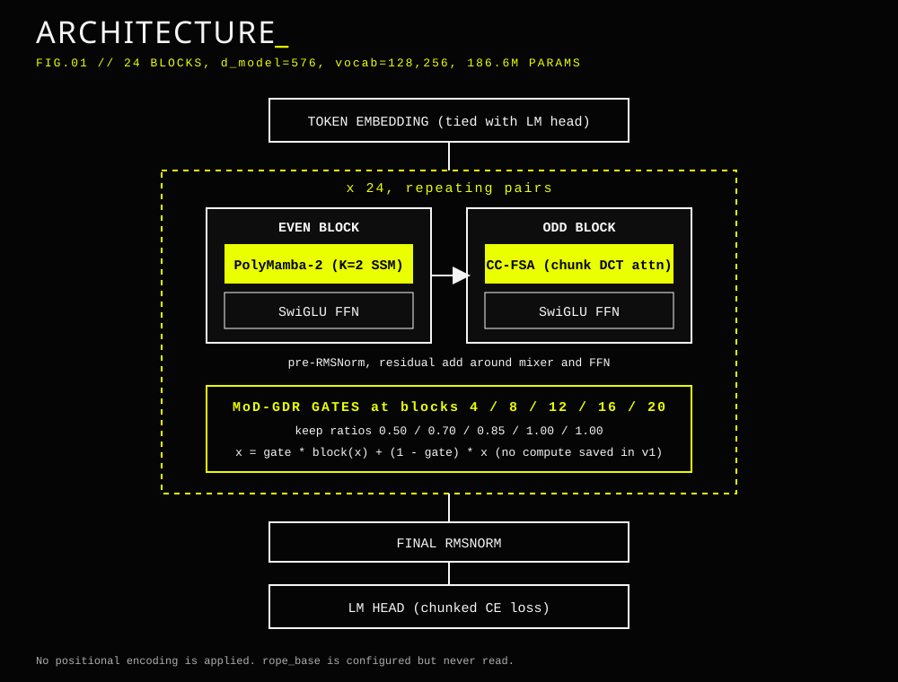
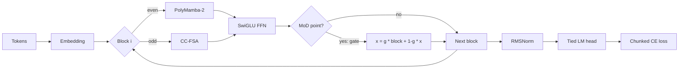
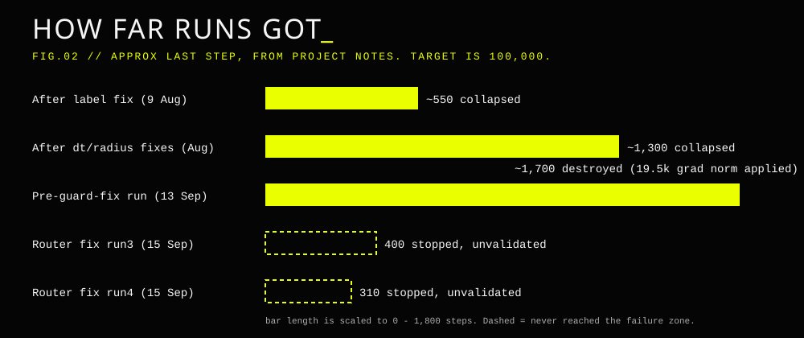
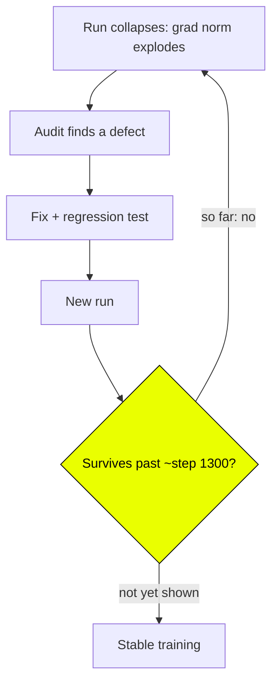
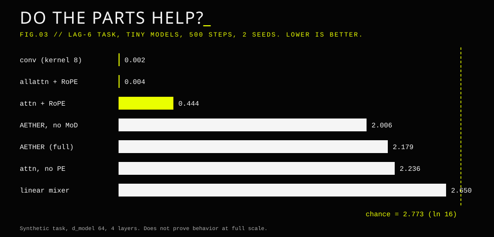

<div align="center">



**An experimental 187M-parameter language model trained from scratch on one consumer AMD GPU.**
Built by [Asirive](https://www.asirive.com) · `/02 Aether`


</div>

---

## `// READ THIS FIRST`

Aether is a **research project, and it does not work yet.**

| Question | Honest answer |
|---|---|
| Is there a trained model? | **No.** No run has survived past roughly step 1,700 of a planned 100,000. |
| Does it beat anything? | **Unknown.** There is no benchmark result. The 8-sample eval probes in `runs/` are noise. |
| Are the novel components justified? | **Not shown.** The only controlled test (tiny models, synthetic tasks) was negative or neutral for all three. |
| Is the training stable? | **Not proven.** Every full run so far has collapsed (grad norm explosion). The latest fixes have not been run past the failure zone. |
| Can I use it for something? | As a codebase to read and a log of what broke and why. Not as a model. |

If you want a small model that works today, fine-tune an existing one. This repo exists to find out whether three unusual ideas hold up at 200M scale. So far the evidence says they have not earned their complexity.

---

## `// WHAT IT IS`

A decoder-only language model, 24 blocks, `d_model=576`, 128,256-token Llama-3 vocabulary, tied embeddings. The target was SmolLM2-360M-class quality at about half the parameters on a single RX 7600 (8 GB). It combines three non-standard components:

<div align="center">

</div>

| Component | What it does | Prior art you should read first |
|---|---|---|
| **CC-FSA** (odd blocks) | Splits keys/values into 32-token chunks, runs a DCT per chunk, keeps a learned top-8 frequency bins per head as the chunk summary. Queries attend to past-chunk summaries plus raw tokens in their own chunk. | FNet, GFNet, AFNO, NSA |
| **PolyMamba-2** (even blocks) | Two parallel linear SSMs with different structure matrices (identity and tridiagonal), mixed by a per-token gate. The spectral radius of the transition is clamped at 0.95. | Mamba, Liquid-S4 |
| **MoD-GDR** (blocks 4/8/12/16/20) | Top-k depth routing as a residual gate. In v1 it does not save compute, because blocks still run densely. | Mixture-of-Depths (Raposo et al.) |

None of these is claimed as novel. Full specification: [`docs/architecture.md`](docs/architecture.md).



---

## `// WHAT WENT WRONG`

The history in this repo is mostly a debugging log. Several real bugs were found and fixed, and each time the run still died. The pattern says the design has more than one source of instability, so patching one at a time has not converged.

<div align="center">

</div>

| Round | Finding | Verified how |
|---|---|---|
| B1 | The first FSA leaked future tokens (past logits moved by 1.28 when future tokens changed). | Probe, then redesigned as CC-FSA. |
| B2–B4 | MoD zeroed skipped tokens, and two aux losses were identically zero. | Probes. |
| B23 | Labels were shifted twice, so the model trained on t+2 prediction. | Successor-ring regression test. |
| B26/B27 | The SSM backward pass amplified gradients roughly 1,000x. | Spectral radius clamp. |
| PAF-8 | bf16 optimizer state froze parameters; the grad-norm guard was dead code. | Measured per-parameter update rates. |
| PAF-9/10 | The MoD router read the un-normalised residual stream. | CPU mini-reproduction. **Not confirmed on a full run.** |

Full audit logs: [`docs/debug_report_2026-07-31.md`](docs/debug_report_2026-07-31.md), [`docs/debug_report_2026-09-13.md`](docs/debug_report_2026-09-13.md), and the PAF sections of [`AGENTS.md`](AGENTS.md).



---

## `// DO THE PARTS HELP?`

Controlled single-variable test on tiny models with synthetic memory tasks ([`docs/component_attribution_2026-09-15.md`](docs/component_attribution_2026-09-15.md)). Lower is better; chance is 2.773.

<div align="center">

</div>

- **MoD routing:** made things worse (+0.17 nats, non-overlapping seeds) and saves no compute.
- **CC-FSA:** never beat plain causal attention, and stayed at chance on the content-based induction task.
- **PolyMamba-2:** beat a pointwise linear mixer, but lost to a cheap causal convolution.

The authors' own confidence in this result is 70%. The models were tiny and the tasks synthetic, so it does not prove the components fail at full scale. It does mean nobody has shown they help. The missing piece is a same-data, same-recipe vanilla transformer baseline.

---

## `// QUICK START`

> Developed on Windows 11 with the AMD HIP SDK 7.1.1 (RX 7600, `gfx1102`). WSL2 ROCm does not work for this GPU.

```powershell
powershell -ExecutionPolicy Bypass -File scripts/env_setup_windows.ps1

python scripts/benchmark.py                 # sanity: should report >= 8 TFLOPS bf16
python -m pytest tests/ -q                  # unit tests (see note below)
python scripts/smoke_pretrain.py --steps 5 --seq-len 256 --micro-batch 2

python -m aether.training.pretrain --config configs/aether_200m.yaml --no-tui
```

- Test-suite counts in the notes range from 99 to 116 passing. They were **not re-run** when this README was written.
- Measured throughput is about 4,000 tokens/s, so the planned 6.55B tokens is roughly **19 days** of continuous training.
- This machine has an integrated GPU at device 0 that hard-crashes ROCm. Use `aether.utils.device.select_device()`.
- Do not run GPU work while training; it collapses throughput.

---

## `// REPO MAP`

```
aether/
  components/   CC-FSA, PolyMamba-2, MoD router
  ops/          DCT, soft top-k
  training/     data stream, optimizer, curriculum, trainer
  post_train/   SFT and DPO (written, never run successfully)
  eval/         lm-eval-harness runner
configs/        200M, 25M proxy, stability-validation configs
ablations/      component attribution harness (+ random-token stability scripts)
tests/          unit and math regression tests
docs/           architecture, audits, resume notes
assets/         diagrams used by this README
```

---

## `// WHAT WOULD MAKE THIS REAL`

1. **A vanilla baseline** on the exact same recipe, trained past the failure zone. If it is stable and Aether is not, the components are the problem.
2. **Add components one at a time** to that baseline. The first one that breaks training is the culprit.
3. **A run that survives** past step 3,000 with a flat grad norm. Until then, no claim about the architecture is supported.
4. **Real benchmarks** via lm-eval-harness on a checkpoint with enough tokens.
5. **Edge numbers** (decode speed, memory). None exist yet.

If the baseline wins everywhere, the honest write-up is a negative result.

---

<div align="center">

`ASIRIVE_` · built in Singapore · Apache-2.0

</div>
